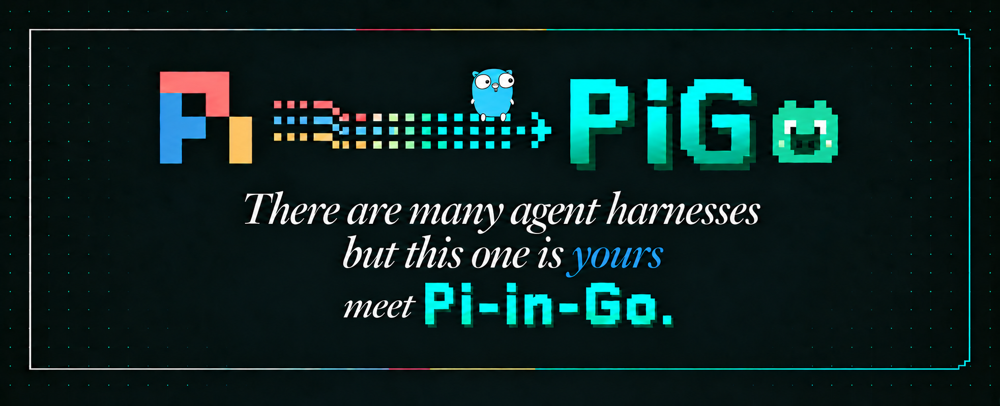

<!--
SPDX-License-Identifier: MIT
-->

<p align="center">
  
</p>

# Ompig

[](https://github.com/tmih06/ompig/actions/workflows/ci.yml)
[](https://github.com/tmih06/ompig/actions/workflows/security.yml)
[](https://scorecard.dev/viewer/?uri=github.com/tmih06/ompig)
[](https://www.bestpractices.dev/projects/14941)
[](https://api.reuse.software/info/github.com/tmih06/ompig)
[](https://pkg.go.dev/github.com/tmih06/ompig)
[](go.mod)
[](LICENSE)
[](https://github.com/tmih06/ompig/releases)
[](https://github.com/earendil-works/pi/commit/6c384aa30f619d7b28963f2bab24d8dacbe73cb6)
[](test/parity/coverage.md)
[](https://x.com/OmpigCodingAgent)
[](https://www.reddit.com/r/OmpigCodingAgent/)

Ompig is [Pi](https://github.com/earendil-works/pi), the minimal and extensible coding agent for the terminal, rebuilt in Go as one native binary. It starts quickly, needs no Node.js, and runs Pi's TypeScript extensions unchanged. You can also write extensions in Go, Rust, or Python, and bundle extensions, skills, and prompts into a Ompiglet: one named agent you can share or build into its own executable.

Ompig is a pre-stable 0.x release. Core paths are ported and checked against Pi 1.4.0+6c384aa3 with paired parity scenarios; edge cases are still hardening. See the [port status](test/parity/coverage.md) and [file map](docs/parity/PORT_MAP.md) for current scope and evidence.

If Ompig behaves differently from Pi, that is either a bug or a documented divergence. Windows support is a preview.

## Install

On macOS, Linux, or Android with [Termux](docs/site/docs/termux.md) (arm64):

```bash
curl -fsSL https://ompig.dev/install.sh | sh
```

On Windows, in PowerShell:

```powershell
irm https://ompig.dev/install.ps1 | iex
```

With npm, on any supported platform:

```bash
npm install -g @ompig/ompig
```

With Go:

```bash
go install github.com/tmih06/ompig/cmd/ompig@latest
```

You can also download an archive from [GitHub Releases](https://github.com/tmih06/ompig/releases) or [build from source](#build-from-source). [ompig.dev/install](https://ompig.dev/install) covers every method, including updates and uninstalling.

## Quick start

Start Ompig in the directory where you want it to work, run `/login` to connect a subscription or set your provider's API key (for example `OPENAI_API_KEY`), then ask it something:

```bash
cd /path/to/project
ompig
```

Interactive `/login` masks secret input by default. Turn off **Mask secret input** in `/settings` to restore Pi's plain-text typing and submitted input (D80). See [login privacy](docs/site/docs/providers.md#authentication).

The [documentation](https://ompig.dev/docs/latest) covers everything else, starting with the [quickstart](https://ompig.dev/docs/latest/quickstart). You can also ask Ompig to explain itself.

## Upstream Pi

Pi is the reference implementation. Ompig follows Pi's behavior and design unless a Go constraint or an approved product-neutral requirement makes a difference necessary.

Use the upstream project for Pi itself:

- [Pi source](https://github.com/earendil-works/pi)
- [Pi documentation](https://pi.dev/docs/latest)
- [Earendil Works](https://github.com/earendil-works)
- [Pi community](https://discord.com/invite/3cU7Bz4UPx)

Ompig is not an official Pi release. The Pi maintainers do not endorse Ompig.

## Origins

Michael Kinsy created Ompig working at Hewlett Packard Enterprise.

Ompig is maintained as an independent open-source project. Project decisions, issues, and contributions belong in this repository. See [docs/project/GOVERNANCE.md](docs/project/GOVERNANCE.md) and [docs/project/MAINTAINERS.md](docs/project/MAINTAINERS.md).

## Compatibility philosophy

Ompig adds a Go implementation to the Pi ecosystem and follows the Pi reference implementation.

- Preserve observable compatibility with Pi.
- Treat the pinned Pi release as the reference behavior.
- Minimize unnecessary divergence.
- Record each intentional user-visible or interoperability difference.
- Prefer changes that reduce the cost of the next upstream sync.
- Share generally useful findings with the broader ecosystem when the contribution route permits it.

The pinned Pi build is 1.4.0+6c384aa3, commit `6c384aa30f619d7b28963f2bab24d8dacbe73cb6` of the main branch. The pin names the behavior oracle. It does not claim that every upstream change is already ported: [`test/parity/coverage.md`](test/parity/coverage.md) reports verified behavior, and the upgrade ledgers under [`test/parity/upstream-sync/`](test/parity/upstream-sync/) list each upstream change and its disposition.

Ompig's current package scope covers Pi's agent, AI, coding-agent, and TUI
packages. It does not implement Pi's experimental remote Session packages or
its standalone telemetry and evaluation packages. See
[`docs/parity/PORT_MAP.md`](docs/parity/PORT_MAP.md) for the exact boundary.

## Project facts

- Binary: `ompig`
- Go module: `github.com/tmih06/ompig`
- Configuration root: `~/.ompig/`, or `OMPIG_HOME`
- Agent directory: `~/.ompig/agent`, or `OMPIG_CODING_AGENT_DIR`
- Pi version pin: [`.upstream/pin`](.upstream/pin) (a release tag or a pinned commit; `PI_UPSTREAM_REF=<tag|commit>` overrides it for one run, `make pin-bump` moves it)
- Local upstream mirror: `.upstream/current/`
- Main verification gate: `make check`
- Full verification and coverage refresh: `make verify`

`ompig --version` prints Ompig's version as `<Ompig release>+<Pi release>`, for example `0.5.3+1.4.0+6c384aa3` (D63): the Pi release is semver build metadata, so the version sorts as the Ompig release. `ompig version` prints the Ompig release and the pinned Pi release as separate fields. Neither command reads user configuration.

## Repository map

| Path          | Responsibility                                                                     |
| ------------- | ---------------------------------------------------------------------------------- |
| `agent/`      | Pi-compatible Agent loop, messages, and harness Session state.                     |
| `ai/`         | Pi-compatible providers, model catalog, authentication, and streaming types.       |
| `coding/`     | Public coding-agent SDK, extension contracts, Package support, and Ompiglet support. |
| `tui/`        | Public terminal components, rendering, input, and terminal lifecycle.              |
| `cmd/ompig/`    | Stock Ompig command-line application and RPC process surface.                        |
| `internal/`   | Private implementation used by Stock Ompig. External modules cannot import it.       |
| `extensions/` | Go, Rust, Python, and declaration-only TypeScript extension SDKs.                  |
| `ompiglets/`    | Explicit agent compositions such as Ompig Standard and Ompig Porter.                   |
| `test/parity/`     | Pinned Pi correspondence, scenarios, inventories, and generated evidence.          |
| `test/`      | Integration, extension-conformance, clean-repository, and upstream-contract tests. |
| `docs/`       | Maintainer references and the static public documentation site.                    |
| `examples/`   | Small extension and embedding examples.                                            |
| `automation/` | Build, generation, CI, release, layout, and maintainer tooling. |

Ompig aligns public package boundaries with Pi's `agent`, `ai`, `coding-agent`,
and `tui` packages. Go files within a package follow cohesive implementation
responsibilities instead of mirroring TypeScript file mechanics. `docs/parity/PORT_MAP.md`
records every source correspondence.

## Stock Ompig and compositions

Stock Ompig is the product-neutral binary built from this repository. It does not
activate Ompig Standard Resources, product authentication, product APIs, or
deployment-specific behavior.

A Ompiglet explicitly selects Resources, tools, discovery, defaults, and environment requirements for one agent. A Package distributes Resources. A Package never owns or activates a Ompiglet. A Ompiglet Binary is a direct executable build output for one pinned Ompiglet composition.

Ompig Standard is the explicit Ompiglet at
[`ompiglets/standard/ompig-standard.yaml`](ompiglets/standard/ompig-standard.yaml).
It currently selects the extension-provided Ompig login, sprite catalogue, and
Ompig Runner. Run it from source with:

```bash
ompig --ompiglet ompiglets/standard/ompig-standard.yaml
```

Stock Ompig never selects this composition implicitly. A Package can distribute
its Resources, but a Package cannot own or activate the Ompiglet.

See [CONTEXT.md](docs/project/CONTEXT.md) and [docs/README.md](docs/README.md) for the project terms and documentation map.

## Security boundary

Ompig runs with the permissions of the user who starts it. Ompig does not provide a security sandbox for model output, tools, extensions, skills, hooks, or shell commands.

Use a container, virtual machine, or another operating-system boundary when you need isolation. Load extensions and project instructions only from sources you trust. See [.github/SECURITY.md](.github/SECURITY.md).

## Install with npm

Install the command with npm (Node.js 18 or newer):

```bash
npm install -g @ompig/ompig
ompig --version
```

Or run it once without installing:

```bash
npx @ompig/ompig --version
```

`ompig` itself is the native binary: npm installs the matching platform package
(`@ompig/ompig-<os>-<cpu>`, for macOS, Linux and Windows on x64 and arm64, and Android on arm64 for Termux) as
an optional dependency, and Node.js runs only a small launcher. Do not install
with `--omit=optional` or `--no-optional`, which leaves the binary out. Update
with `npm update -g @ompig/ompig` and uninstall with
`npm uninstall -g @ompig/ompig`. `ompig update` does not replace an
npm-installed binary; update through npm.

## Install with Go

Install the command without a source checkout with Go 1.26 or newer:

```bash
go install github.com/tmih06/ompig/cmd/ompig@latest
```

Go writes the `ompig` executable to `GOBIN`, or to the `bin` directory of the first
`GOPATH` entry when `GOBIN` is unset: `$(go env GOPATH)/bin`, which is
`~/go/bin` by default (`%USERPROFILE%\go\bin` on Windows). Add that directory to
`PATH`. With an older Go 1.21 or later and the default `GOTOOLCHAIN=auto`, Go
downloads a new enough toolchain automatically. Release binaries are built with
Go 1.27.3.

Use an exact release such as `@v0.2.0` when reproducibility matters. Update a Go
installation by running `go install` again. Each release tags the root module
(`v0.2.0`) and the Go extension SDK module (`extensions/sdk/v0.2.0`) on the same
commit; `go install` needs both.

## Build from source

Ompig currently supports source builds on Linux, macOS, and Windows. Do not treat a platform as release-supported until its native release verification passes.

Requirements:

- Go 1.27.3
- Git
- macOS 13 or later for native macOS builds
- Node.js 24.22.1 and npm 12.1.0 for parity tooling
- Python 3.12 for Python SDK tests
- Rust 1.97.1 for Rust SDK tests
- tmux for terminal parity tests on Unix

Build the binary:

```bash
go build -o bin/ompig ./cmd/ompig
./bin/ompig --version
```

Prepare the exact Pi comparator and source mirror:

```bash
make upstream-mirror
```

Run the main local gate:

```bash
make check
```

The `upstream-mirror` target installs the Pi comparator of the pin: the lockfile-pinned package for a release tag, or a build of the pinned commit. It retrieves the exact Pi source and verifies its commit against [`.upstream/pin`](.upstream/pin).

## Contract model

- `.upstream/current/` is the local source-language mirror.
- Go code is the target implementation.
- [`docs/parity/PORT_MAP.md`](docs/parity/PORT_MAP.md) maps tracked upstream files.
- `test/parity/scenarios/` records observed behavior.
- [`test/parity/coverage.md`](test/parity/coverage.md) reports generated verification status.
- [`docs/parity/DIVERGENCES.md`](docs/parity/DIVERGENCES.md) records intentional differences.
- [`AGENTS.md`](AGENTS.md) defines maintenance rules.
- [`Makefile`](Makefile) defines build, test, parity, and release gates.

A ported row means that code exists. It does not prove behavioral compatibility. A non-deferred scenario must exercise and assert the mapped behavior.

## Extensions

Ompig supports Go, Rust, Python, and Node extension factories through its public extension host. Extensions can register tools, commands, event handlers, flags, shortcuts, providers, and user-interface contributions.

Node extensions use Pi's TypeScript extension API. Ompig supplies compatible
runtime modules. The declaration-only package in `extensions/sdk-ts` adds types
for Ompig-only extension capabilities without replacing Pi's TypeScript runtime.

Start with:

- [Extension authoring](docs/extension-authoring.md)
- [Extension API parity](docs/extension-api-parity.md)
- [Extension runtime cells](docs/extension-runtime-cells.md)

Use `ompig extension init <directory>` to scaffold an extension. Use `ompig install <path> --validate-only --json` to validate it.

## Supply-chain evidence

Ompig treats scanner output as evidence input, not as proof by itself. Release preparation builds a validated dependency inventory and artifact-specific SPDX SBOMs. Reviewers reconcile scanner findings with Go modules, npm locks, Python metadata, Rust locks, embedded assets, generated data, and release contents.

See [docs/supply-chain.md](docs/supply-chain.md) for the inventory, SBOM, vulnerability, license, signing, and provenance requirements.

## Project policies

- Read [.github/CONTRIBUTING.md](.github/CONTRIBUTING.md) before proposing a change.
- Read [.github/SECURITY.md](.github/SECURITY.md) before reporting a vulnerability.
- Read [.github/SUPPORT.md](.github/SUPPORT.md) before requesting support.
- Read [docs/project/GOVERNANCE.md](docs/project/GOVERNANCE.md) and [docs/project/MAINTAINERS.md](docs/project/MAINTAINERS.md) for project ownership.
- Read [LICENSE](LICENSE), [NOTICE](NOTICE), and [THIRD_PARTY_NOTICES.md](THIRD_PARTY_NOTICES.md) for licensing and attribution.

## Acknowledgements

Ompig would not exist without Pi and the work of its maintainers and contributors. Their design and open-source work provide the reference that Ompig follows.

Thank you to everyone who contributes to Pi and Ompig. Maintainers are listed in [`docs/project/MAINTAINERS.md`](docs/project/MAINTAINERS.md), every contributor appears on [GitHub's contributors page](https://github.com/tmih06/ompig/graphs/contributors), and the [changelog](CHANGELOG.md) credits each fix to the person who reported or contributed it.

## Star History

[](https://www.star-history.com/?repos=tmih06%2Fompig&type=timeline&legend=top-left)
